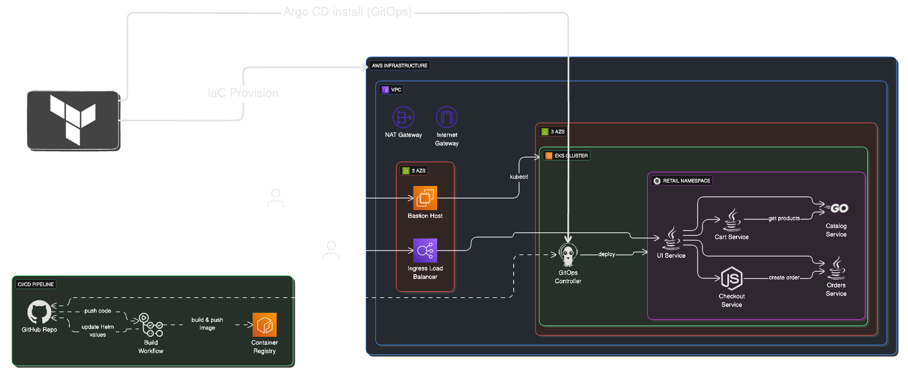

# shop

A cloud-native retail store on AWS EKS with a fully automated delivery pipeline.
Push to `main` and it is built, published, deployed and monitored automatically.


## Overview

shop is a microservices retail store made of five services: **ui**, **catalog**, **cart**,
**checkout** and **orders**. The project focuses on the platform around the application:

- **Infrastructure as code.** Terraform builds the VPC, the EKS cluster and the add-ons.
- **Continuous integration.** GitHub Actions builds only the services that changed.
- **Private registry.** Images are stored in Amazon ECR, one repository per service.
- **GitOps delivery.** Argo CD keeps the cluster in sync with the Git repository.
- **Observability.** Prometheus and Grafana show cluster and app health.

## Architecture



1. A developer pushes code to GitHub.
2. GitHub Actions builds the image and pushes it to Amazon ECR.
3. The workflow commits the new image tag to the Helm chart.
4. Argo CD detects the commit and syncs the chart to Amazon EKS.
5. Users reach the shop through ingress-nginx and a load balancer.

## Tech stack

| Area | Tools |
|---|---|
| Cloud | AWS (VPC, EKS, ECR, Load Balancer), region `ap-south-1` |
| Infrastructure as code | Terraform with `terraform-aws-modules` for VPC and EKS |
| CI / CD | GitHub Actions, Argo CD |
| Ingress | ingress-nginx, cert-manager |
| Monitoring | Prometheus, Grafana (`kube-prometheus-stack`) |

## Repository structure

```
.github/workflows/
  deploy.yml            CI pipeline
argocd/
  applications/         One Argo CD application per service
  projects/             Argo CD project (allowed repositories)
src/
  app/chart/            Helm chart for the app
  ui/ catalog/ cart/ checkout/ orders/    Services: source, Dockerfile, Helm chart
terraform/
  main.tf               VPC and EKS cluster with a managed node group
  addons.tf             ingress-nginx and cert-manager
  argocd.tf             Argo CD installation and applications
```

## Getting started

**1. Configure AWS credentials**

```bash
aws configure
aws sts get-caller-identity
```

Use the same credentials for Terraform and kubectl, because the identity that creates the
cluster gets admin access.

**2. Create the infrastructure in three phases**

The Kubernetes and Helm providers need the cluster first, so apply in stages.

```bash
cd terraform
terraform init
terraform apply -target=module.vpc                # network
terraform apply -target=module.retail_app_eks     # cluster and nodes
terraform apply                                   # add-ons, Argo CD and apps
```

**3. Connect kubectl and open the shop**

```bash
aws eks update-kubeconfig --region ap-south-1 --name <cluster_name>
kubectl get svc -n ingress-nginx ingress-nginx-controller
```

Open the load balancer hostname over `http://`.

## CI/CD pipeline

The **Deploy** workflow runs on every push to `main` that changes a file under `src/`.

1. **Detect changes.** It finds which services changed and builds only those.
2. **Build and push.** Each image goes to ECR as `demo-project-<service>:<short-sha>`.
3. **Update the chart.** The new repository and tag are written to `values.yaml`.
4. **Commit.** The change is committed to `main` with `[skip ci]` to avoid a loop.

Repository secrets used by the pipeline:

| Secret | Purpose |
|---|---|
| `AWS_ACCESS_KEY_ID` | Access key of the IAM user that pushes to ECR |
| `AWS_SECRET_ACCESS_KEY` | Secret key of that user |
| `AWS_ACCOUNT_ID` | Account ID used to build the ECR address |

Set Settings, Actions, General, Workflow permissions to **Read and write** so the workflow
can commit the new image tag.

## GitOps with Argo CD

Argo CD watches the `main` branch of this repository. When the pipeline commits a new
image tag, Argo CD syncs the Helm chart and rolls out the new pods. The five services are
separate Argo CD applications in the `retail-store` project, and this repository must be
listed in that project's `sourceRepos`.

```bash
kubectl get applications -n argocd
kubectl port-forward svc/argocd-server -n argocd 8080:443      # https://localhost:8080
```

## Monitoring

Prometheus and Grafana are installed with the `kube-prometheus-stack` Helm chart.

```bash
helm repo add prometheus-community https://prometheus-community.github.io/helm-charts
helm install monitoring prometheus-community/kube-prometheus-stack -n monitoring --create-namespace
kubectl port-forward svc/monitoring-grafana -n monitoring 3000:80      # http://localhost:3000
```

A custom dashboard shows nodes, pods, restarts, CPU, memory and network traffic.

## Troubleshooting

| Problem | Fix |
|---|---|
| `Invalid target "module"` in PowerShell | Quote it: `terraform apply "-target=module.vpc"` |
| `You must be logged in to the server` | Use the identity that created the cluster, or add an EKS access entry |
| Pods stay `Pending` | The nodes are full, so add nodes to the managed node group |
| Docker build fails on `./mvnw` | Run `sed -i 's/\r$//' mvnw && chmod +x mvnw` in the Dockerfile |

## Clean up

The cluster, NAT gateway, nodes and load balancer cost money every hour.

```bash
kubectl delete ingress -A --all
cd terraform
terraform destroy
```

## Credits

The application is based on the AWS Containers Retail Sample app. The infrastructure,
pipeline, GitOps setup, monitoring and UI redesign in this repository are my own work.