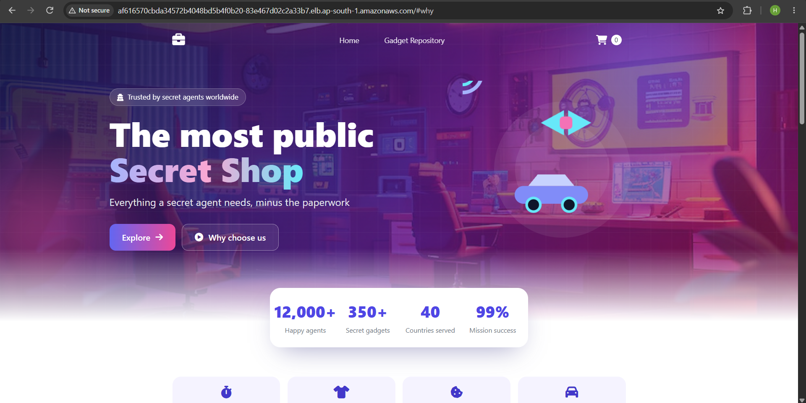
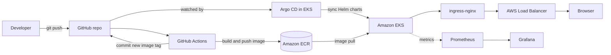

# Secret Shop: a retail store on AWS EKS with GitOps

A microservices retail store running on Amazon EKS with a fully automated delivery pipeline.
Terraform builds the infrastructure, GitHub Actions builds and publishes the images, Argo CD
deploys them to the cluster, and Prometheus and Grafana monitor everything.
A commit to `main` goes live with no manual steps.



## What this project demonstrates

- Infrastructure as code with Terraform (VPC and EKS modules, managed node group, add-ons)
- Continuous integration with GitHub Actions (detects changed services, builds only those)
- A private container registry on Amazon ECR
- GitOps continuous delivery with Argo CD and Helm charts
- Ingress with ingress-nginx and an AWS load balancer
- Monitoring with Prometheus and Grafana, including a custom dashboard
- A redesigned UI home page (Thymeleaf template) deployed through the pipeline

## Architecture




## Tech stack

| Layer | Tooling |
|---|---|
| Infrastructure as code | Terraform (`terraform-aws-modules` for VPC and EKS) |
| Cluster | Amazon EKS with a managed node group, region `ap-south-1` |
| Networking | VPC with public and private subnets, NAT gateway, ingress-nginx |
| Registry | Amazon ECR, one repository per service (`demo-project-<service>`) |
| CI | GitHub Actions |
| CD | Argo CD with Helm charts |
| Monitoring | Prometheus and Grafana (`kube-prometheus-stack`) |
| Application | Retail store microservices: ui, catalog, cart, checkout, orders |

## Repository layout

```
.github/workflows/
  deploy.yml              CI pipeline: build, push to ECR, update the Helm image tag
argocd/
  applications/           Argo CD application for each service
  projects/               Argo CD project (allowed repositories and namespaces)
src/
  app/chart/              Helm chart for the app
  ui/                     UI service: source, Dockerfile and Helm chart
  catalog/                Catalog service
  cart/                   Cart service
  checkout/               Checkout service
  orders/                 Orders service
terraform/
  main.tf                 VPC and EKS cluster with a managed node group
  addons.tf               ingress-nginx and cert-manager
  argocd.tf               Argo CD installation and applications
  security.tf             Security groups and rules
  variables.tf, locals.tf, outputs.tf, versions.tf
.gitattributes, .gitignore
```

## Infrastructure (Terraform)

Terraform creates the network, the cluster, the add-ons and Argo CD in three phases, because
the Kubernetes and Helm providers need the cluster to exist first.

```bash
cd terraform
terraform init
terraform apply -target=module.vpc               # phase 1: network
terraform apply -target=module.retail_app_eks    # phase 2: EKS cluster and nodes
terraform apply                                  # phase 3: add-ons, Argo CD, apps

aws eks update-kubeconfig --region ap-south-1 --name <cluster_name>
kubectl get nodes
```

## CI pipeline (GitHub Actions)

On every push to `main` that changes `src/<service>/`, the **Deploy** workflow:

1. Detects which services changed and builds only those.
2. Builds each Docker image and pushes it to ECR as `demo-project-<service>:<short-sha>`.
3. Writes the new `image.repository` and `image.tag` into that service's `chart/values.yaml`.
4. Commits the change to `main` with a `[skip ci]` message so it does not trigger itself.

Required repository secrets: `AWS_ACCESS_KEY_ID`, `AWS_SECRET_ACCESS_KEY`, `AWS_ACCOUNT_ID`.
The workflow needs read and write permissions under Settings, Actions, General.

## Continuous delivery (Argo CD)

Argo CD watches the `main` branch of this repository. When the pipeline commits a new image tag,
Argo CD detects the change, syncs the Helm chart, and rolls out the new pods. Each of the five
services is its own Argo CD application, and all of them belong to the `retail-store` project.

```bash
kubectl get applications -n argocd
kubectl port-forward svc/argocd-server -n argocd 8080:443     # https://localhost:8080
```

## Monitoring (Prometheus and Grafana)

Prometheus and Grafana are installed with the `kube-prometheus-stack` Helm chart.

```bash
helm repo add prometheus-community https://prometheus-community.github.io/helm-charts
helm repo update
helm install monitoring prometheus-community/kube-prometheus-stack -n monitoring --create-namespace

kubectl port-forward svc/monitoring-grafana -n monitoring 3000:80     # http://localhost:3000
kubectl port-forward svc/monitoring-kube-prometheus-prometheus -n monitoring 9090:9090
```

A custom "Number Board" dashboard shows the health of the app at a glance: nodes ready, pods
running, restarts, CPU and memory use, network traffic, and how much of the cluster's pod
capacity is used.

## See it running

```bash
kubectl get pods -n retail-store
kubectl get svc -n ingress-nginx ingress-nginx-controller
```

Open the load balancer hostname over `http://` to see the store.

## Troubleshooting and lessons learned

| Problem | Cause | Fix |
|---|---|---|
| `Invalid target "module"` in PowerShell | PowerShell splits `-target=module.vpc` at the dot | Quote the argument: `terraform apply "-target=module.vpc"` |
| `You must be logged in to the server` | Only the identity that created the cluster has admin access | Run kubectl with the same credentials, or add an EKS access entry for the other identity |
| Pods stuck in `Pending` after adding monitoring | Small nodes hit their per-node pod limit | Add nodes to the managed node group |
| Docker build fails on `./mvnw` | `mvnw` committed from Windows lacks the executable bit and has CRLF line endings | `RUN sed -i 's/\r$//' mvnw && chmod +x mvnw` in the Dockerfile |
| Push rejected, files over 100 MB | The `.terraform` folder was committed | Add `**/.terraform/` to `.gitignore` and remove it from git |
| Argo CD: repo "is not permitted in project" | The project's `sourceRepos` list only allowed the original repository | Add this repository to `sourceRepos` and to each application's `repoURL` |
| Workflow failed on `git push origin gitops` | The original workflow pushed to a `gitops` branch | Push to the branch that triggered the run (`main`) |
| 503 from nginx after a deploy | The new pod could not be scheduled | Check `kubectl describe pod`, then add capacity or fix the page |

## Clean up

The cluster, NAT gateway, nodes and load balancer cost money every hour. When you are done:

```bash
kubectl delete ingress -A --all
cd terraform
terraform destroy
```

Then delete the ECR repositories you no longer need, check EC2 for leftover volumes and load
balancers, and deactivate the IAM access keys used by the pipeline.

## Credits

The application is based on the AWS Containers Retail Sample app. The infrastructure,
pipeline, GitOps setup, monitoring and UI redesign in this repository are my own work.